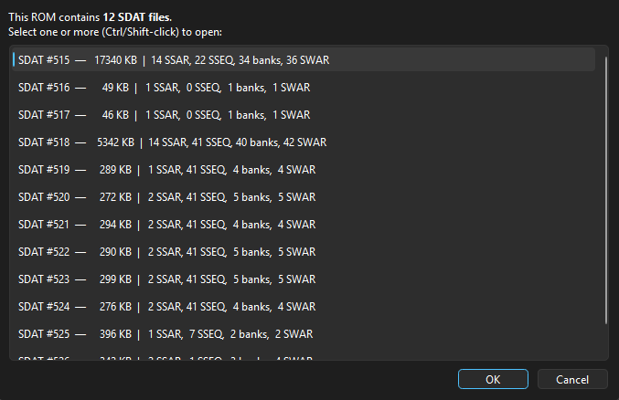
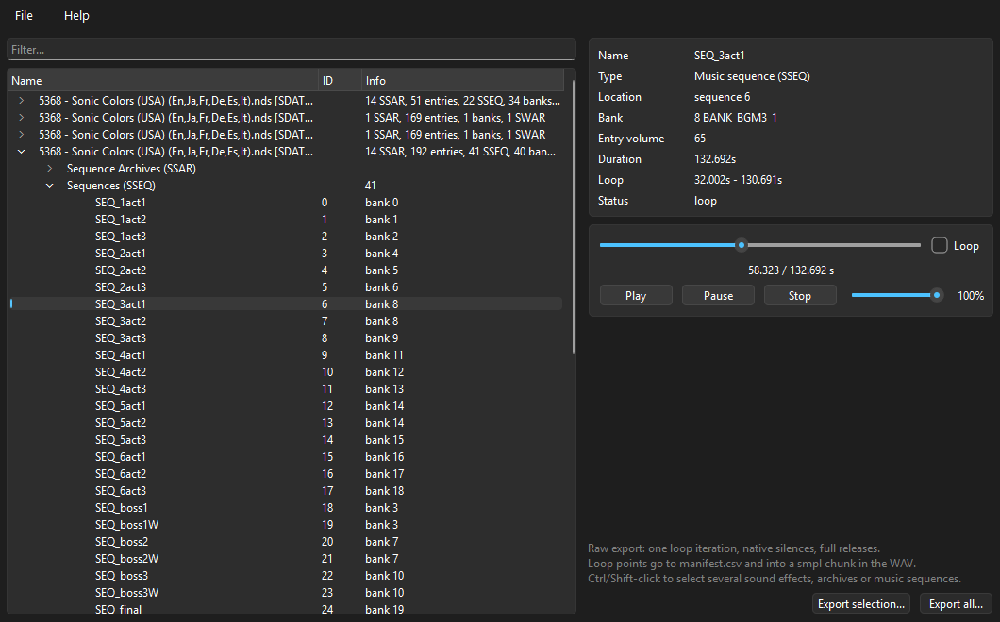
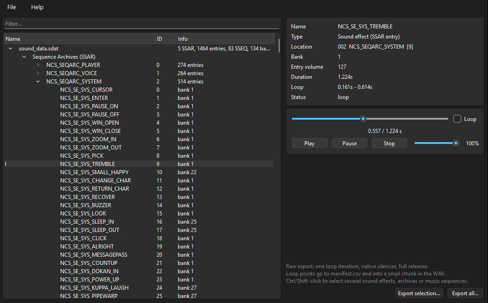
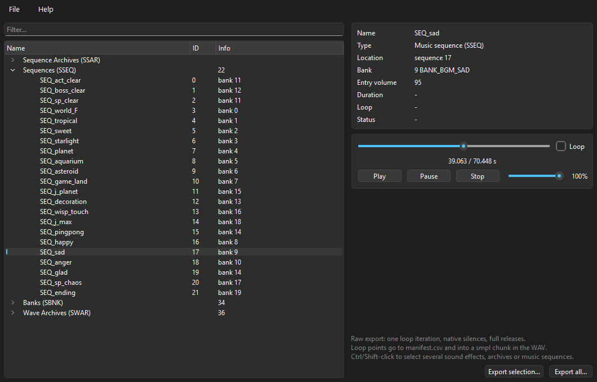
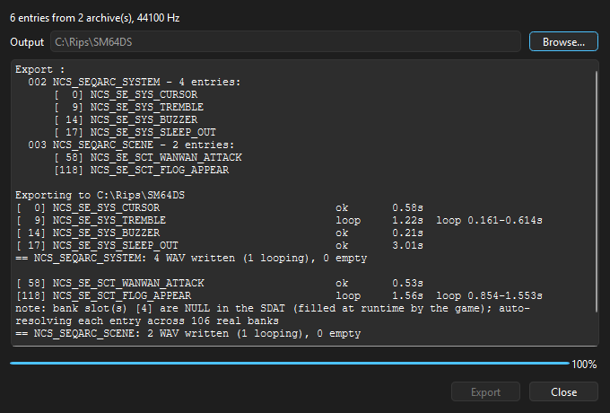

<div align="center">
    
    <h1>DualRip</h1>
    <p><strong>Rips Nintendo DS sound effects (SSAR) & music (SSEQ) from <code>sound_data.sdat</code>, and Nintendo 3DS sounds (CSEQ sequences, CWSD wave sounds, BCSTM streams) from CSAR archives, to WAV by emulating each console's sound driver.</strong></p>
    <p><strong>CLI + GUI</strong></p>
  
[](https://github.com/TetraSsky/DualRip/releases)
[](https://www.python.org/)
[](https://pypi.org/project/numpy/)
[](https://pypi.org/project/ndspy/)
[](LICENSE)
[](#)
[](#)

[What you get](#what-you-get) · [Screenshots](#screenshots) · [Usage](#usage) · [Dynamic bank slots](#dynamic-bank-slots-nds) · [Credits](#credits) · [Code](#code) · [Requirements](#requirements) · [Build](#build)
</div>

<br>

## What you get

- One loop iteration per sound or song, full release envelopes, native rests preserved.
- Loop points in `manifest.csv` and embedded in the WAV as a `smpl` chunk.
- 3DS streams (BCSTM) decode bit-exact, sequences and wave sounds render through the same raw-export policy as NDS.
- Multi-channel 3DS streams keep their stereo layers apart: one WAV per layer (`_c0-1`, `_c2-3`, ...), a single multichannel WAV, or both.
- Every sequenced format (NDS effects and music, 3DS sequences, DSE music and effects) previews live: exact length and loop points first, then synthesis on demand with instant seek.

## Screenshots

Shown for DS; 3DS ROMs (`.cia`/`.3ds`) and `.bcsar` archives use the same picker/tree/preview/export.

Open a `.nds` ROM: pick one or more SDATs from the selection dialog (Ctrl/Shift-click for multiple):



Browse multiple SDATs side-by-side, grouped by archive:



Browse the SDAT, preview sound effects with the built-in player (seek, pause, loop on the sound's own loop points):



Music sequences with full-length seek bar and live playback:



Batch export with per-entry log, loop points and bank auto-resolution notes:



## Usage

```
dualrip --file sound_data.sdat --archive all --out MyRip
dualrip --file sound_data.sdat --sequence all --out MyMusic
dualrip --file game.nds --archive-index 0 --archive all --out MyRip
dualrip --file game.cia --folder all --out MyRip
dualrip --file game.3ds --list
```

| Option | Effect |
|---|---|
| `--file PATH` | path to a `.sdat`, a `.nds` ROM, a 3DS ROM (`.cia`/`.3ds`) or a `.bcsar` archive |
| `--archive-index N` | when `--file` holds several SDATs/CSARs, pick one (0 = first). Omit to list them. |
| `--archive N` | NDS: rip one SSAR archive, or `all` (default when no `--sequence`) |
| `--sequence N...` | NDS: rip these SSEQ music indices, or `all` (into an `SSEQ/` subfolder) |
| `--folder NAME...` | 3DS: rip these CSAR folders (see `--list`), or `all` (default) |
| `--list` | list archives/folders and exit without ripping |
| `--rate N` | sample rate (default 44100) |
| `--only I J...` | only these entry/sound indices |
| `--bank-map "4=32+33"` | NDS only: override bank resolution |
| `--group NAME` | 3DS only: pick the per-group variant whose label contains `NAME` (the error lists the candidates) |
| `--group-all` | 3DS only: for an ambiguous sound, write one file per candidate group (`NAME__GROUP.wav`) instead of failing |
| `--boot9 PATH` | 3DS only: path to the console's boot ROM dump (only required for encrypted ROMs) |

GUI: open a `.sdat`/`.nds` or a 3DS `.cia`/`.3ds`/`.bcsar`, browse/filter, double-click to preview any sound effect or music track (seek, pause, loop on its own loop points), Ctrl/Shift-select sound effects, archives, sequences or 3DS folders and export. Files with several SDATs/CSARs let you pick several at once via the selection dialog. A multi-channel 3DS stream also lists its stereo layers (`c0-1`, `c2-3`, ...), each playable and exportable on its own.

## Dynamic bank slots (NDS)

Some games leave bank slots null in the SDAT and fill them at runtime.
DualRip resolves these automatically (family-affinity + coverage ranking).
The resolution shows up in the manifest (`4->33`); `--bank-map` overrides.

## Multi-channel streams (3DS)

A 3DS stream can carry more than two channels, and each stereo pair is an independent layer of the same track (menu themes add a layer per screen, courses ship alternate mixes). DualRip exposes them as `c0-1`, `c2-3`, ... under the stream, plays them separately and exports what you select :
- selecting the stream exports every layer,
- selecting layers exports only those,
- the export dialog offers `One file per layer`, `One multichannel file` (all layers in one WAV, channel order `c0, c1, c2, ...`) or `Both`.

Layers are never mixed: the file's channels are the data, a mix would be a choice the game makes per screen. Most players keep only the first pair of a multichannel WAV; a DAW shows every channel, and one layer can be extracted with `ffmpeg -i stream.wav -filter_complex "pan=stereo|c0=c2|c1=c3" layer.wav`.

3DS CBNK banks don't have this null-slot mechanism, but the same file can exist in several per-group variants (the ROM ships one variant per course or sound set). DualRip never guesses between them: the sound is reported as ambiguous with the list of candidate groups, and `--group NAME` (CLI) or the `3DS group variant` field in Settings picks one. `--group-all` (CLI) or the matching export checkbox writes one file per candidate group instead.

## Credits

Core is a Python port of the FeOS Sound System (fincs), via Naram Qashat's
NCSF player ([in_xsf](https://github.com/CyberBotX/in_xsf)). Tables from
Nintendo NNS driver disassembly. Adds two behaviors missing upstream:
note-wait on endless notes (voice chaining) and portamento sweep on tied notes.
The 3DS CSEQ renderer is a separate, self-contained implementation.

## Code

```
dualrip/formats/sdat/          SWAR/SWAV, SBNK, SDAT, NDS ROM extraction (parsing)
dualrip/formats/ctr/           CSAR/CSEQ/CBNK/CWAR/CWSD/BCSTM, 3DS ROM extraction (parsing)
dualrip/engine/sdat/           DS sequencer/channel/render, cprims + lookup tables
dualrip/engine/ctr/            3DS CSEQ sequencer/channel/render, cprims + LUTs
dualrip/bankmap.py             static patch scan + auto bank resolution
dualrip/export.py              WAV/manifest, public API: render_one / rip_archive / rip_sequences / rip_ctr_folder
dualrip/cli.py, gui/           frontends
```

Each console has a parsing half (`formats/<fmt>/`) and an engine half (`engine/<fmt>/`), split the same way: `sdat` for DS, `ctr` for 3DS. Deps go one way parsing never imports its engine the engine consumes parsed structures passed in (banks, wave samples, a bank-lookup callback), so `engine/*` never imports `formats/*`. `export.py` (DS) and the `CtrArchive` facade (3DS) bridge the two halves. Nothing outside `gui/` imports Qt. Golden tests in `tests/test_golden.py` pin both renderers bit-for-bit, one gate per format: `DUALRIP_TEST_SDAT` (DS), `DUALRIP_TEST_CTR` (3DS sequences, streams and layers, `DUALRIP_TEST_BOOT9` when the image is encrypted), `DUALRIP_TEST_STRM` and `DUALRIP_TEST_STRM_PCM8` (DS streams, PCM16 and PCM8)  `DUALRIP_TEST_DSE` (DS without an SDAT). Each half skips itself when its variable is unset, so a bare run stays green.

## Requirements

<a href="https://www.python.org/"></a>
<a href="https://pypi.org/project/numpy/"></a>
<a href="https://pypi.org/project/ndspy/"></a>
<a href="https://pypi.org/project/pyctr/"></a>
<a href="https://pypi.org/project/PySide6/"></a>
<a href="https://pypi.org/project/sounddevice/"></a>

Decrypted `.cia`/`.3ds` files and loose `.bcsar` archives open with no extra requirement an encrypted ROM additionally needs the console's boot ROM dump (`boot9.bin`), set in Settings (GUI or passed with `--boot9` (CLI). No game data included.

## Build

```
pip install -e .[gui] pyinstaller
pyinstaller dualrip.spec          # dualrip_linux.spec / dualrip_macos.spec elsewhere
```

One-file build, bundles Python, PySide6 and the icon. `build_exe.bat` / `build_linux.sh` / `build_macos.sh` wrap the same command per platform.
Linux needs `libportaudio2` and the Qt xcb libs installed on the build machine (see the `apt-get` step in `.github/workflows/release.yml`).
Pre-built binaries for Windows, Linux and macOS are available on the releases page.
